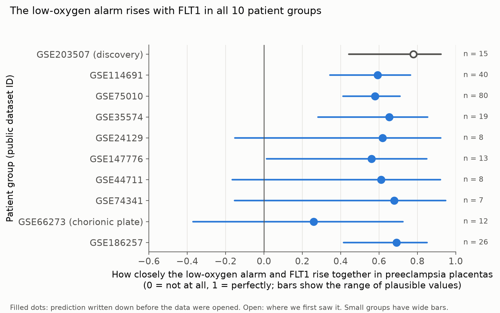

# [Team Name]: A Low-Oxygen Alarm in the Early-Preeclampsia Placenta

OpenBio 2026 Datathon, Track 1: Maternal-Fetal Cell Communication in Preeclampsia



## Team

| Name | Role |
|---|---|
| [Team member 1] | [Analysis, ...] |
| [Team member 2] | [Article, video, ...] |

## Research Question

Do hypoxia and glycolysis gene-activity signals in early-onset preeclampsia (EOPE) placentas persist when cases are compared with preterm controls (and adjusted for gestational age), are they specific to preeclampsia rather than fetal growth restriction, and which placental cell types plausibly carry them?

## Data Used

- [x] GSE203507 bulk RNA-seq, villous tissue, 30 donors (required)
- [x] Zeisel/Admati gene browser: FLT1, LEP, HK2, NDRG1, P4HA1 (required) → [`notebooks/results/browser_lookups.csv`](notebooks/results/browser_lookups.csv)
- [x] Admati/Skarbianskis single-cell pseudobulk files (optional extension)
- [x] GSE203507 decidua basalis bulk RNA-seq (optional extension)
- [x] Other public data: GSE114691 villous RNA-seq, 79 placentas ([GEO](https://www.ncbi.nlm.nih.gov/geo/query/acc.cgi?acc=GSE114691)), used for replication
- [x] Other public data: MSigDB Hallmark gene sets v2024.1 (HYPOXIA, GLYCOLYSIS), downloaded by the notebook from the [Broad data server](https://data.broadinstitute.org/gsea-msigdb/msigdb/release/2024.1.Hs/)

## How to Run

```bash
git clone https://github.com/Bakdaulet-omeraiuly/openbio-track1-preeclampsia.git
cd openbio-track1-preeclampsia
python3 -m venv .venv && source .venv/bin/activate
pip install -r requirements.txt jupyter
cd notebooks
jupyter nbconvert --to notebook --execute --inplace 01_metabolic_stress_analysis.ipynb
jupyter nbconvert --to notebook --execute --inplace 02_followup_pseudobulk_and_specificity.ipynb
jupyter nbconvert --to notebook --execute --inplace 03_stress_tests.ipynb
jupyter nbconvert --to notebook --execute --inplace 05_external_replication.ipynb
jupyter nbconvert --to notebook --execute --inplace 06_headline_figure.ipynb
jupyter nbconvert --to notebook --execute --inplace 07_celltype_coupling_and_meta.ipynb
jupyter nbconvert --to notebook --execute --inplace 08_coupling_PE_vs_FGR.ipynb
jupyter nbconvert --to notebook --execute --inplace 09_hypoxia_independent_flt1_program.ipynb
jupyter nbconvert --to notebook --execute --inplace 10_villous_to_decidua.ipynb
jupyter nbconvert --to notebook --execute --inplace 11_anchor_gene_null.ipynb
```

The first notebook clones the official datathon data package at a **pinned commit** (`fb751e9`) next to this repository and downloads the Hallmark gene sets, so no data files need to be copied by hand. Run the notebooks in order: later notebooks read result files written by earlier ones. Notebook 05 also downloads GSE114691 counts from GEO and a transcript-to-gene table from Ensembl GRCh37 BioMart.

Reproducibility details:

- Notebook files: `notebooks/01_…` to `11_…`, run in order (about 10–15 minutes in total on a laptop)
- Where we ran it: our own computer (macOS, Python 3.13, packages pinned in `requirements.txt`)
- Random seeds: `numpy` seed 42 (random gene sets, notebook 03); PyDESeq2 is deterministic
- Analysis plan committed **before** tests were run; follow-up analyses registered as Addenda A–H before they were run (see git history of `docs/analysis-plan.md`)

## Files

| Path | Contents |
|---|---|
| `notebooks/01_metabolic_stress_analysis.ipynb` | Pre-registered analysis: QC, PCA, PyDESeq2 PE vs preterm controls, sensitivity analyses S1–S4, hypoxia/glycolysis scores, marker table |
| `notebooks/02_followup_pseudobulk_and_specificity.ipynb` | Addendum A: independent single-cell (pseudobulk) check, PE vs FGR-only direct contrasts, shared vs set-specific genes |
| `notebooks/03_stress_tests.ipynb` | Addendum B: random-gene-set null, FLT1 link, heterogeneity within PE, decidua, composition adjustment |
| `notebooks/05_external_replication.ipynb` | Addendum C: pre-specified replication in GSE114691 (79 placentas), FLT1 within PE in single-cell data, FDR summary |
| `notebooks/06_headline_figure.ipynb` | Headline figure (both cohorts) |
| `notebooks/07_celltype_coupling_and_meta.ipynb` | Addendum D (post hoc): hypoxia–FLT1 coupling in 14 cell classes, two-cohort meta-analysis |
| `notebooks/08_coupling_PE_vs_FGR.ipynb` | Addendum E: pre-specified test of whether hypoxia–FLT1 coupling differs between PE and growth restriction; same-gene and leave-one-out robustness |
| `notebooks/09_hypoxia_independent_flt1_program.ipynb` | Addendum F: FLT1 co-expression module beyond the Hallmark hypoxia score, built in GSE114691 and tested in GSE203507 |
| `notebooks/10_villous_to_decidua.ipynb` | Addendum G: paired villous stress vs decidual (maternal-side) inflammatory response; negative result |
| `notebooks/11_anchor_gene_null.ipynb` | Addendum H: selection-process null (same procedure for 300 random anchor genes) |
| `notebooks/results/` | All result tables (DE results, robust hits, scores, contrasts, browser lookups) |
| `figures/` | Exported graphs, including `headline.png` |
| `docs/article.md` | Science communication article |
| `docs/analysis-plan.md` | Comparison, model, thresholds, and addenda |
| `docs/hypothesis-card.md` | Our hypothesis and how to test it |
| `docs/presentation-outline.md` | Video script |

## Key Findings

- Comparing 15 EOPE placentas with 5 gestational-age-appropriate preterm controls (`~ fetal sex + PE`), 424 genes pass padj < 0.05 and |log2FC| ≥ 1; 207 survive a gestational-age covariate and every leave-one-control-out refit.
- Discovery: a hypoxia score is higher in EOPE than in preterm controls (+0.54, 95% CI 0.24–0.84) and, in a direct contrast, than in FGR-only placentas (+0.35, 0.08–0.63). The "glycolysis" signal comes from genes shared with the hypoxia set; glycolysis-only genes do not rise in PE. The effect exceeds all 1,000 expression-matched random gene sets.
- **Replication in 79 different patients (GSE114691), with predictions registered before running:** the hypoxia-only score is again higher in EOPE than preterm controls (+0.21, 0.06–0.37; beats 98% of random gene sets), glycolysis-only genes are lower, and the score tracks FLT1 within 40 PE placentas (rho = 0.59). **Not replicated:** PE vs growth-restriction-only (+0.11, −0.03 to 0.25); growth-restricted placentas show a weaker version of the signal.
- The hypoxia score tracks FLT1 (sFlt-1 gene; not in the set) within PE (rho = 0.78) and in independent single-cell syncytiotrophoblast (rho = 0.72). In the independent pseudobulk data the hypoxia score is higher in early PE in both cytotrophoblast and syncytiotrophoblast (exploratory, 3 control donors). The gene browser places FLT1 and LEP mainly in syncytiotrophoblast/EVT.

- Post hoc (Addendum D): pooling both cohorts gives a modest PE excess over growth restriction (+0.16, 0.04–0.28; I² = 40%). In the single-cell data, the hypoxia score tracks FLT1 specifically (FLT1 in the top 5% of all genes) in syncytiotrophoblast, extravillous trophoblast and endothelial cells.
- Pre-specified (Addendum E): the hypoxia → FLT1 coupling is **similar** in PE and growth restriction (GSE114691 interaction −0.31, 95% CI −0.92 to 0.29; within-group rho 0.59 vs 0.58). Descriptively, in GSE114691 PE placentas carry higher FLT1 at the same hypoxia score (+1.07 on the VST scale, not a fold change); this offset was not seen in the small discovery cohort. Robust to using identical genes in both cohorts and to leave-one-out.
- **FLT1 co-expression beyond the Hallmark hypoxia score (Addenda F and H):** a 50-gene module built in GSE114691 and tested in GSE203507 (previously analysed, not used for building) tracks FLT1 after removing the hypoxia score (partial rho = 0.89). It is the canonical PE gene set (LEP, ENG, PAPPA2, HTRA4, INHBA, FSTL3…). Against a selection-process null (same procedure for 300 random genes of similar expression) FLT1 ranks at the 95.7th percentile, just above the pre-set 95% bar; its PE > FGR shift is not FLT1-specific (76th percentile). Interpreted as reproducible co-expression, not a separate mechanism, and **not new**: it re-derives the FLT1/ENG/LEP 'VT Blue' vs HIF/glucose 'VT Black' module split already reported by Ackerman et al. 2023.
- **Negative (Addendum G):** in 22 paired preterm pregnancies, villous hypoxia did not predict the same pregnancy's decidual inflammatory response beyond shuffled pairs (p = 0.61); PE vs FGR-only could not be answered (little overlap in stress levels, 5 FGR).

## Limitations

5 preterm controls and 5 FGR-only placentas; 3 early control donors in the single-cell data. Bulk tissue mixes cell types and our deconvolution is approximate. Labour and delivery mode (possible acute hypoxia) are not recorded for the bulk samples. A similar signal in decidua means we cannot call it villus-specific. The replication cohort has no public per-sample covariates (GA, sex, delivery mode), its controls laboured, and it was also used by Ackerman et al. for module discovery. Expression data show association, not cause. Addenda A–H were planned after seeing earlier results and are labelled as such. Gene-browser plots are from a different study and are used as context only; we read the condition legend (early/late, control/PE) from the browser's legend bars.

## Presentation

Video link: [add your unlisted YouTube link]

## Citations

- Ackerman WE et al. (2023) Hypertension 80:1363–1374. [doi:10.1161/HYPERTENSIONAHA.122.20807](https://doi.org/10.1161/HYPERTENSIONAHA.122.20807) (GSE203507)
- Admati I, Skarbianskis N et al. (2023) Med 4:687–709. [doi:10.1016/j.medj.2023.07.005](https://doi.org/10.1016/j.medj.2023.07.005) (single-cell data and gene browser)
- Awamleh Z, Gloor GB, Han VKM (2019) BMC Med Genomics 12:91. [doi:10.1186/s12920-019-0548-x](https://doi.org/10.1186/s12920-019-0548-x) (GSE114691)
- Zhang R et al. (2026) Curr Gene Ther. [doi:10.2174/0115665232535282261029093348](https://doi.org/10.2174/0115665232535282261029093348)
- Piekos SN et al. (2025) Commun Biol 8:1239. [doi:10.1038/s42003-025-08631-6](https://doi.org/10.1038/s42003-025-08631-6)
- Leavey K et al. (2016) Hypertension 68:137–47. [doi:10.1161/HYPERTENSIONAHA.116.07293](https://doi.org/10.1161/HYPERTENSIONAHA.116.07293)
- Zhao J et al. (2020) FASEB BioAdv 3:23–35. [doi:10.1096/fba.2020-00057](https://doi.org/10.1096/fba.2020-00057)
- Iriyama T et al. (2015) Hypertension 65:1307–15. [doi:10.1161/HYPERTENSIONAHA.115.05314](https://doi.org/10.1161/HYPERTENSIONAHA.115.05314)
- Campbell KA et al. (2023) Commun Biol 6:264. [doi:10.1038/s42003-023-04623-6](https://doi.org/10.1038/s42003-023-04623-6)
- Gerber HP et al. (1997) J Biol Chem 272:23659–67. [doi:10.1074/jbc.272.38.23659](https://doi.org/10.1074/jbc.272.38.23659)
- Maynard SE et al. (2003) J Clin Invest 111:649–58. [doi:10.1172/JCI17189](https://doi.org/10.1172/JCI17189)
- Zeisler H et al. (2016) N Engl J Med 374:13–22. [doi:10.1056/NEJMoa1414838](https://doi.org/10.1056/NEJMoa1414838)
- Liberzon A et al. (2015) The Molecular Signatures Database Hallmark gene set collection. Cell Syst 1:417–425. [doi:10.1016/j.cels.2015.12.004](https://doi.org/10.1016/j.cels.2015.12.004)
- Muzellec B et al. (2023) PyDESeq2. Bioinformatics 39:btad547. [doi:10.1093/bioinformatics/btad547](https://doi.org/10.1093/bioinformatics/btad547)
