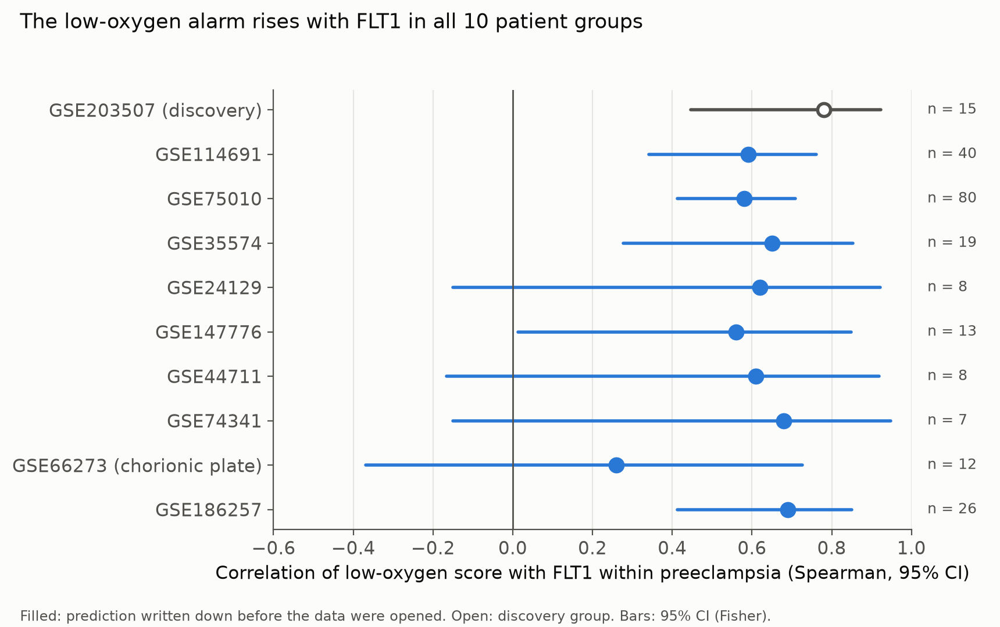
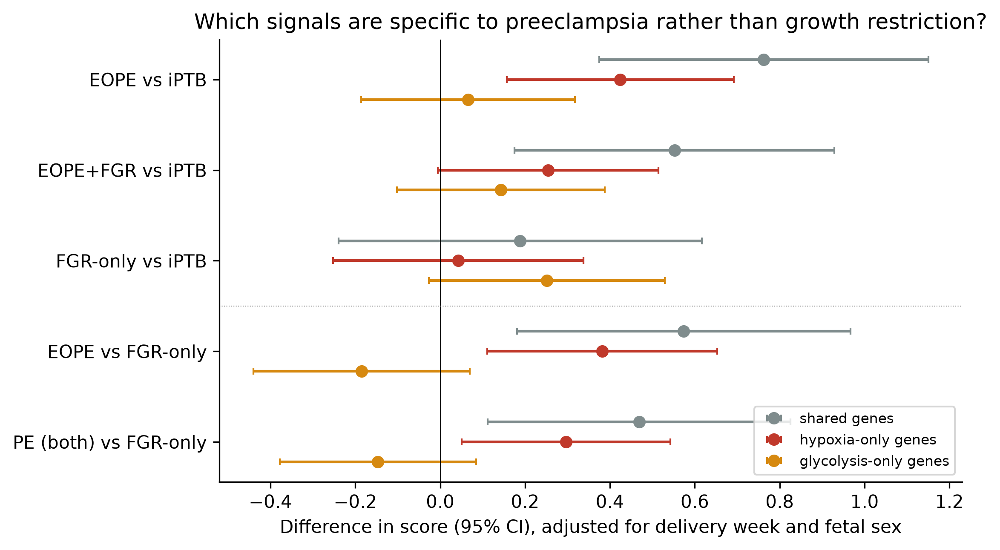
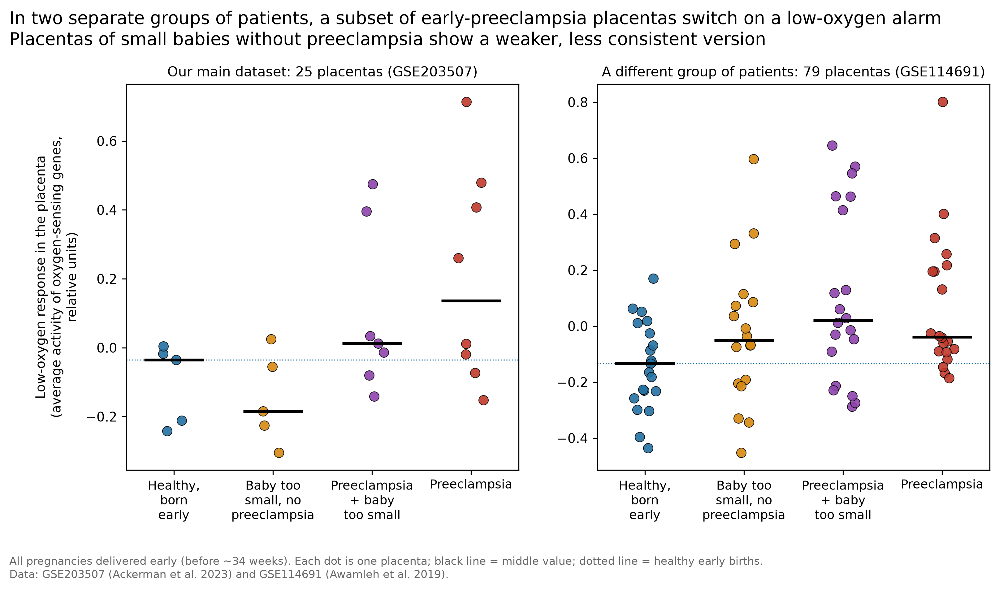
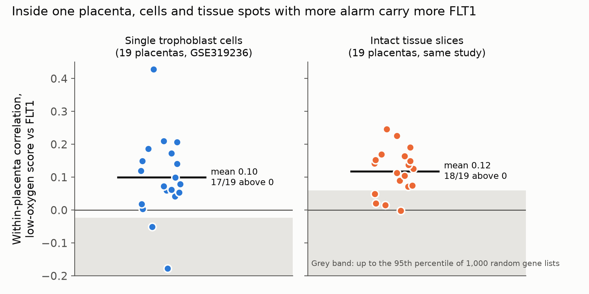
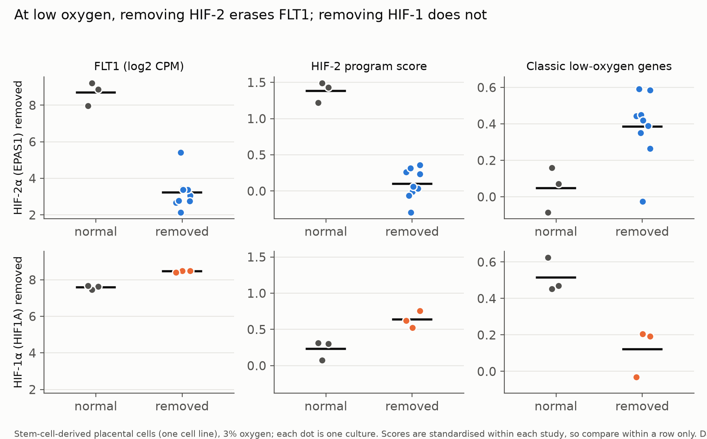
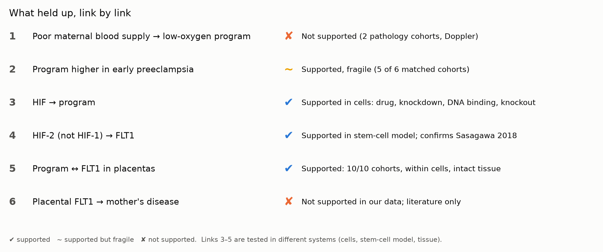

# A Low-Oxygen Alarm in the Preeclampsia Placenta

**A low-oxygen alarm rises with FLT1, the gene behind preeclampsia's main blood test. It does so in all ten patient groups we tested, inside single placental cells and in intact tissue, and FLT1 needs the HIF-2 sensor. But two parts of the textbook story did not hold up in our data.**

By Bakdaulet Omertayev (team 404: Team Not Found)

Figure 1. The correlation between the low-oxygen alarm and FLT1 within preeclampsia, in ten groups of patients
studied by different research teams.

- 1 means a perfect ranking match, and 0 means no relation.
- Nine groups were tested with the prediction written down before the data were opened (filled dots).
- All ten are positive. The combined estimates in the planned tests were 0.47–0.69.

## Introduction

Preeclampsia is a pregnancy disorder in which the mother's blood pressure rises dangerously, often with kidney or
liver damage. The only cure is delivering the placenta. The early-onset form, which appears before 34 weeks, is
the most severe.

The textbook story is a chain of six links:

1. Poor blood supply starves the placenta of oxygen.
2. The placenta switches on a low-oxygen alarm.
3. A sensor protein called HIF runs that alarm.
4. HIF turns on the gene FLT1.
5. More FLT1 means more sFlt-1, the protein measured in the clinical sFlt-1/PlGF blood test
   ([Zeisler et al. 2016](https://doi.org/10.1056/NEJMoa1414838)).
6. sFlt-1 damages the mother's blood vessels.

A 2023 study of our main placentas described a "sugar-burning" (glycolytic) pattern in some early-preeclampsia
placentas ([Ackerman et al. 2023](https://doi.org/10.1161/HYPERTENSIONAHA.122.20807)). We set out to test that
signal, and then each link of the chain, with public data.

## The Data and Our Methods

Our main data are gene-activity measurements (RNA sequencing) from 30 placentas
([GSE203507](https://www.ncbi.nlm.nih.gov/geo/query/acc.cgi?acc=GSE203507)):

- 15 early preeclampsia;
- 5 small-baby (growth restriction) without preeclampsia;
- 5 healthy early births;
- 5 healthy term births.

We then tested every main claim in **other, independent public datasets**:

- ten bulk-tissue patient groups;
- single-cell and intact-tissue ("spatial") data;
- DNA-binding data;
- stem-cell experiments in which HIF genes were switched off;
- two cohorts with placental pathology.

**Before opening each new dataset, we committed our prediction, test and pass rule to the public repository.**
We report every result, including failures. As a check against "any gene list would do", each gene-score result
is compared with 1,000 random gene lists of similar activity.

**The main limit is size.** Several groups have fewer than 10 placentas, and most data come from placentas
collected at delivery, so they show association, not cause.

## What We Found

### The "sugar" signal is really a low-oxygen signal

We split two published gene lists, low-oxygen ("hypoxia") genes and sugar-burning ("glycolysis") genes, into
shared, low-oxygen-only and sugar-only parts.

- In early preeclampsia, **low-oxygen-only genes were higher** than in healthy placentas delivered at the same stage.
- **Sugar-only genes were not.**
- The shift was larger than for all 1,000 random gene lists of the same size.

The "glycolytic" placentas are better described as placentas with an active low-oxygen alarm.

Figure 2. How much higher each score is in one group than another, after adjusting for delivery week and the
baby's sex.

- Dots are estimates, and lines are 95% confidence intervals (the range of plausible values).
- Low-oxygen-only genes rise in preeclampsia; sugar-only genes do not.

Figure 3. Low-oxygen score for each placenta in our main dataset (left) and in a second group of 79 patients
(right).

- Each dot is one pregnancy, and the dotted line marks healthy early births.
- Some preeclampsia placentas sit far above healthy ones, while others look normal.

The alarm was higher in early preeclampsia than in births at the same stage in **five of six** patient groups
where such a comparison was possible. In three small groups tested with a written-down plan, the combined
difference was clear but **fragile**: it depended on one dataset. When the comparison group was mostly
full-term births, the difference disappeared. **It was never clearly higher in preeclampsia than in growth
restriction alone**, so the alarm is shared with small-baby pregnancies rather than specific to preeclampsia.

### The alarm tracks FLT1 everywhere we looked

Within preeclampsia, **placentas with a louder alarm make more FLT1**. FLT1 is not on the alarm gene list, so this
is not a built-in overlap.

Figure 1 shows this across all ten groups.

We also built a sharper gene list from a published experiment: the 100 genes that fall most when a drug blocks
HIF-2 in placental cells. In three patient groups we had never opened, those genes tracked FLT1 **beyond** the
general alarm (0.39, interval 0.19 to 0.57), more than all 1,000 random gene lists. A fourth group repeated it
(0.40).

### It is not just a mix of cell types, and not an artefact of handling

A piece of placenta mixes many cell types. So two placentas could differ simply because one has more of the
cells that make both the alarm genes and FLT1. To rule this out, we compared within each of 20 placentas from a
new study ([GSE319236](https://www.ncbi.nlm.nih.gov/geo/query/acc.cgi?acc=GSE319236)), using two designs:

- **Single cells.** Among unambiguous trophoblast cells, those with more alarm carried more FLT1 in **17 of 19
  placentas**. This was beyond all random gene lists, and it held after we removed cells contaminated by other
  cell types.
- **Intact tissue.** Separating cells is itself stressful, and stress can raise both the alarm and FLT1. So we
  also used thin frozen slices of the same placentas, read spot by spot and never separated. The link held in
  **18 of 19 placentas**, after accounting for which cell types each spot contains.

Figure 4. Each dot is one placenta.

- The value is how strongly the alarm and FLT1 move together inside that placenta.
- The grey band shows what random gene lists reach (up to their 95th percentile).
- Both designs sit clearly above it. The correlations are small, as expected for single cells and tissue spots.

### Which oxygen sensor? HIF-2, not HIF-1

We next tested which of the two HIF sensors is needed.

- **The sensor binds the program genes.** In placental cells kept at 1% oxygen, a HIF protein was found bound
  next to about a quarter of the HIF-2 program genes, three times more often than expected
  ([GSE209936](https://www.ncbi.nlm.nih.gov/geo/query/acc.cgi?acc=GSE209936)). It was **not** found next to FLT1
  itself, so FLT1 may be switched on indirectly.
- **Only HIF-2 is needed for FLT1.** In stem-cell-derived placental cells grown at 3% oxygen, removing the HIF-2α
  gene **cut FLT1 about 44-fold** and lowered the program. Removing HIF-1α did neither. Instead, it lowered the
  classic low-oxygen genes.
  - The cells without HIF-2α were, if anything, *more* mature placental cells, so the drop is not a failure to
    develop.
  - For FLT1 this confirms an earlier study that used a different method
    ([Sasagawa et al. 2018](https://doi.org/10.1038/s41598-018-35745-1)).
  - All these cells come from **one person's stem-cell line**, in an early, embryo-like model.

Figure 5. Placental cells grown from stem cells at 3% oxygen, with HIF-2α (top) or HIF-1α (bottom) switched off.
Each dot is one culture, and the black lines are averages. Data: GSE288288, GSE302997.

### What did not hold up

- **Poor blood supply did not switch on the general alarm.** In 168 placentas with pathologist-recorded poor
  maternal blood supply ([GSE303463](https://www.ncbi.nlm.nih.gov/geo/query/acc.cgi?acc=GSE303463)), and in
  extremely premature placentas with infarcts (dead patches from poor blood supply;
  [GSE154829](https://www.ncbi.nlm.nih.gov/geo/query/acc.cgi?acc=GSE154829)), the general alarm was not higher.
  It also did not track blood-flow scans of the mother's uterine arteries.
  - What *was* higher, in both groups, was **FLT1** itself. In the infarct group this was a test planned in
    advance, and FLT1 beat all random genes.
- **Placental FLT1 did not track how sick the mother was.** Within preeclampsia, FLT1 rose only slightly with
  blood pressure, urine protein or HELLP syndrome, and none passed our bar. FLT1 was already higher in high blood
  pressure **without** preeclampsia.
- **Preeclampsia never separated from growth restriction** (see above).

Figure 6. The six links of the textbook chain and what our tests showed for each.

## Unanswered Questions

- Why does poor blood supply raise FLT1 without raising the general low-oxygen alarm? Possible reasons:
  - delivery-time tissue may not reflect oxygen levels weeks earlier;
  - FLT1 may respond to blood flow through another route.
- Is FLT1 switched on by HIF-2 directly, or through the program it controls?
- Is there anything specific to preeclampsia, rather than shared with growth restriction?

## Conclusions, Limitations and Next Steps

**What held up.** The middle of the chain is strong:

- In placental cells, HIF-2 runs a program of genes, binds many of them, and is needed for FLT1.
- In patients' placentas, that program rises and falls with FLT1 in every group we examined, inside single cells
  and in intact tissue.

**What did not.** We could not show the two ends of the chain in our data:

- that poor blood supply switches on the alarm;
- that placental FLT1 reflects how sick the mother is.

We also found nothing specific to preeclampsia rather than growth restriction. These are honest negatives, not
failures to look. The two ends rest on earlier animal and clinical studies
([Maynard et al. 2003](https://doi.org/10.1172/JCI17189)).

**What is new.** The low-oxygen → HIF-2 → FLT1 biology was known. Our contributions are:

- a planned, ten-group replication of the alarm–FLT1 link, with its weak points reported;
- showing that this link holds within single cells and intact tissue of the same placentas;
- linking a drug-defined HIF-2 program to FLT1 in patients, with genetic evidence that HIF-2 (not HIF-1) is
  needed for both;
- clear negatives for the first and last links.

**Our hypothesis.** In a subset of early preeclampsia, and in growth restriction, placental cells run a
HIF-2-dependent program that keeps FLT1 high. We have not shown what turns it on in patients.

**Limitations.**

- Small groups in several datasets.
- Gene activity measured at delivery.
- One stem-cell line for the HIF-2 versus HIF-1 test.
- Single-cell and intact-tissue results from one study.
- Association, not cause, in all patient data.

**Next steps.**

1. Remove HIF-2α in cells from term placentas at low oxygen and measure released sFlt-1 protein.
2. Stain HIF-2α and FLT1 in placentas with and without poor-blood-supply lesions, with the mother's sFlt-1/PlGF
   ratio.
3. Find a cohort with both placental tissue and maternal blood sFlt-1 to test the last link directly.

**We are wrong if** the alarm stops tracking FLT1 in new placentas, or if removing HIF-2 in term placental cells
leaves FLT1 unchanged.

The full analysis log, with every planned and unplanned test, is in
[`supplementary-results.md`](supplementary-results.md).

## Data and Code

- **Repository:** https://github.com/Bakdaulet-omeraiuly/openbio-track1-preeclampsia
- **Main data:** [GSE203507](https://www.ncbi.nlm.nih.gov/geo/query/acc.cgi?acc=GSE203507) (Ackerman et al. 2023), via the [OpenBio datathon data package](https://github.com/Harvard-Undergraduate-OpenBio/openbio-datathon-2026/tree/main/track-01/data).
- **Patient groups:**
  - [GSE114691](https://www.ncbi.nlm.nih.gov/geo/query/acc.cgi?acc=GSE114691)
  - [GSE75010](https://www.ncbi.nlm.nih.gov/geo/query/acc.cgi?acc=GSE75010)
  - [GSE35574](https://www.ncbi.nlm.nih.gov/geo/query/acc.cgi?acc=GSE35574)
  - [GSE24129](https://www.ncbi.nlm.nih.gov/geo/query/acc.cgi?acc=GSE24129)
  - [GSE147776](https://www.ncbi.nlm.nih.gov/geo/query/acc.cgi?acc=GSE147776)
  - [GSE44711](https://www.ncbi.nlm.nih.gov/geo/query/acc.cgi?acc=GSE44711)
  - [GSE74341](https://www.ncbi.nlm.nih.gov/geo/query/acc.cgi?acc=GSE74341)
  - [GSE66273](https://www.ncbi.nlm.nih.gov/geo/query/acc.cgi?acc=GSE66273)
  - [GSE186257](https://www.ncbi.nlm.nih.gov/geo/query/acc.cgi?acc=GSE186257)
  - [GSE303463](https://www.ncbi.nlm.nih.gov/geo/query/acc.cgi?acc=GSE303463)
  - [GSE154829](https://www.ncbi.nlm.nih.gov/geo/query/acc.cgi?acc=GSE154829)
- **Single-cell and spatial:**
  - Admati/Skarbianskis et al. 2023 ([figshare](https://figshare.com/articles/dataset/Placenta_PE_single_cell_RNAseq_dataset_Admati_Skarbianskis_et_al_/23264102), CC BY 4.0)
  - [GSE319236](https://www.ncbi.nlm.nih.gov/geo/query/acc.cgi?acc=GSE319236)
- **Cell experiments:**
  - [GSE216799](https://www.ncbi.nlm.nih.gov/geo/query/acc.cgi?acc=GSE216799) (HIF-2 inhibitor)
  - [GSE80995](https://www.ncbi.nlm.nih.gov/geo/query/acc.cgi?acc=GSE80995) (ARNT knockdown)
  - [GSE209936](https://www.ncbi.nlm.nih.gov/geo/query/acc.cgi?acc=GSE209936) (HIF binding)
  - [GSE288288](https://www.ncbi.nlm.nih.gov/geo/query/acc.cgi?acc=GSE288288) and [GSE302997](https://www.ncbi.nlm.nih.gov/geo/query/acc.cgi?acc=GSE302997) (HIF-2α and HIF-1α knockouts)
- **Gene lists:** MSigDB Hallmark v2024.1 ([GSEA-MSigDB](https://www.gsea-msigdb.org/gsea/msigdb)).
- **Code:** each test's plan, script and result are in `artifacts/addendum-*/`; summary figures are made by
  `artifacts/summary-figures/make_figures.py`.

## Acknowledgements

We thank:

- the Harvard Undergraduate OpenBio team, for the datathon data package and guides;
- the authors of every public dataset listed above, for sharing their data;
- the Harvard Undergraduate Data Project, for the article guide.
