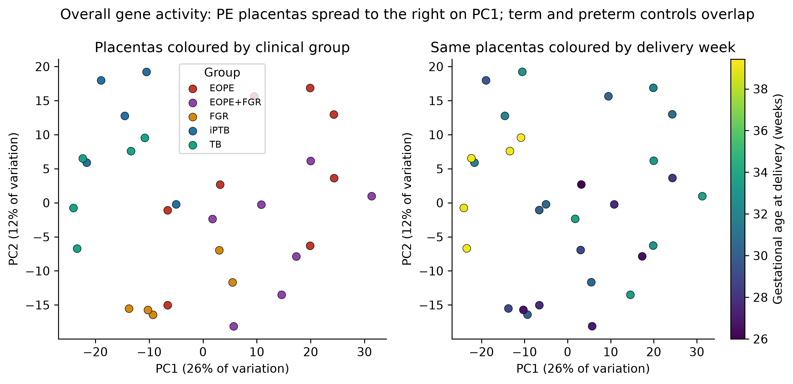
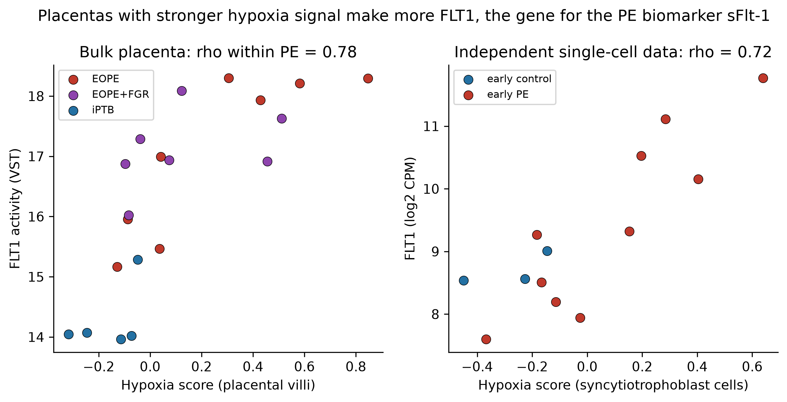
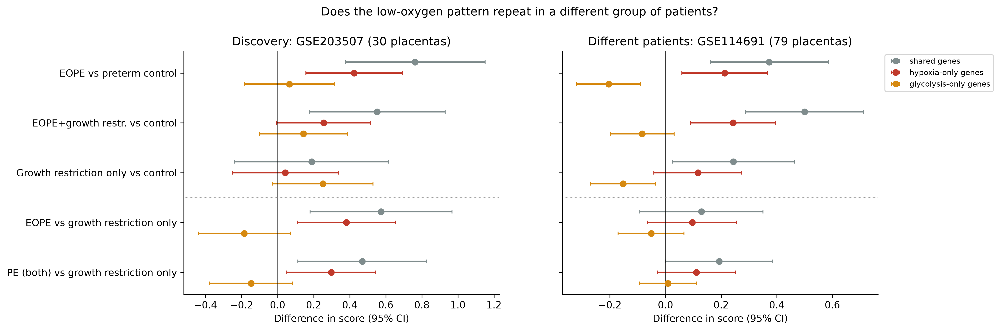
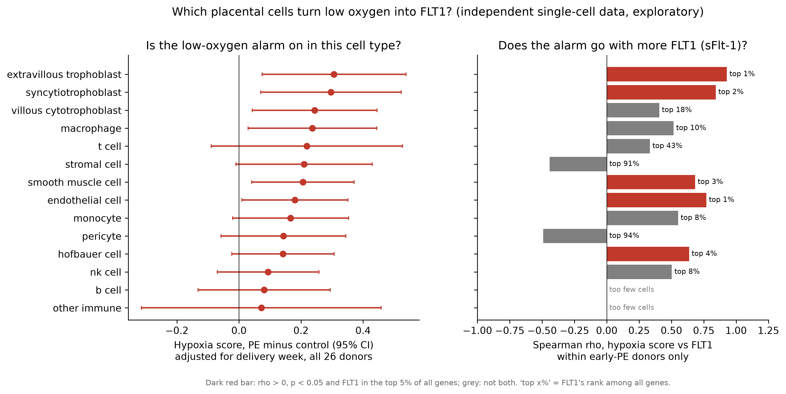
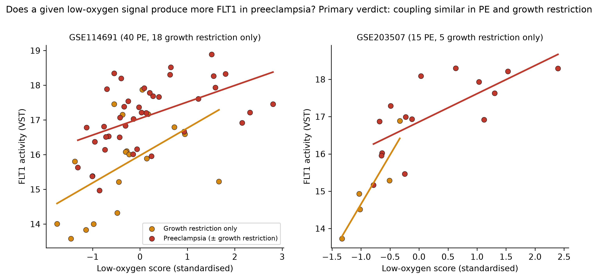
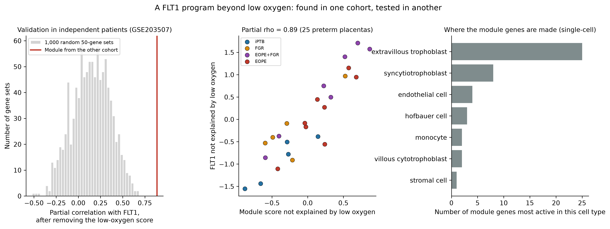

# A Low-Oxygen Alarm in the Preeclampsia Placenta

**In two separate groups of patients, a subset of early-preeclampsia placentas switch on genes that respond to low oxygen, and the alarm rises together with the gene behind the main blood test for the disease.**

By [Team member 1] and [Team member 2]

Figure 1. Low-oxygen gene activity in each placenta, in our main dataset (left, 25 early-delivered placentas) and in a different group of 79 patients (right). Each dot is one pregnancy; the black line is the middle value; the dotted line marks healthy early births. In both groups, some preeclampsia placentas sit far above healthy ones while others look normal. (Data: GSE203507, Ackerman et al. 2023; GSE114691, Awamleh et al. 2019.)

## Introduction

Preeclampsia is a pregnancy disorder in which the mother's blood pressure rises dangerously, often with kidney and liver damage. It affects a few percent of pregnancies, and the only cure is delivering the placenta. The early-onset form, which appears before 34 weeks, is the most severe and often forces a very premature birth.

Doctors have long suspected that the disease starts in the placenta: if the blood vessels feeding it do not develop properly, the placenta may run short of oxygen and release substances that damage the mother's blood vessels. One of those substances, sFlt-1, is now measured in a blood test (the sFlt-1/PlGF ratio) to help diagnose preeclampsia ([Zeisler et al. 2016](https://doi.org/10.1056/NEJMoa1414838)).

A 2023 study of the placentas we analysed reported that some early-preeclampsia placentas look like they have changed how they burn sugar for energy, a pattern called "glycolysis" ([Ackerman et al. 2023](https://doi.org/10.1161/HYPERTENSIONAHA.122.20807)). We asked four questions about that signal:

1. Does it hold up when preeclampsia placentas are compared with placentas delivered at the *same* stage of pregnancy?
2. Is it specific to preeclampsia, or does it also appear when the baby is simply too small?
3. Is it really about sugar metabolism, or about low oxygen?
4. Which placental cells carry it?

## The Data and Our Methods

We used gene-activity measurements (RNA sequencing) from pieces of 30 placentas collected at delivery ([GSE203507](https://www.ncbi.nlm.nih.gov/geo/query/acc.cgi?acc=GSE203507)): 15 with early preeclampsia (7 of them also with a small baby), 5 with a small baby but no preeclampsia ("fetal growth restriction"), 5 healthy pregnancies that delivered early, and 5 healthy full-term pregnancies. Each pregnancy contributes one sample. We checked our findings in an independent single-cell dataset of 26 pregnancies, where activity was measured separately in each type of placental cell ([Admati et al. 2023](https://doi.org/10.1016/j.medj.2023.07.005)), in the maternal side of the same placentas (decidua), and finally in a different group of 79 patients studied by a different research group ([GSE114691](https://www.ncbi.nlm.nih.gov/geo/query/acc.cgi?acc=GSE114691), [Awamleh et al. 2019](https://doi.org/10.1186/s12920-019-0548-x)), whose healthy controls also delivered early. To avoid fooling ourselves, we wrote down our comparisons and cut-offs and saved them before running any test, and marked every analysis added later as such ([analysis plan](analysis-plan.md)). **The main limit is size: the key control group has only 5 placentas**, and the single-cell check has only 3 early control pregnancies, so our results are exploratory.

## What We Found

### Choosing the right comparison matters

Preeclampsia forces early delivery, so a naive comparison with full-term placentas mixes up "preeclampsia" with "earlier in pregnancy." We therefore compared preeclampsia placentas with healthy placentas delivered at a similar stage (30–33 weeks), and also adjusted for the exact delivery week and the baby's sex.

Figure 2. A map of overall gene activity (principal component analysis): each dot is a placenta, and placentas with similar activity sit close together. Preeclampsia placentas spread to the right, while healthy early and full-term placentas overlap on the left, so in these samples disease mattered more than delivery week for the overall pattern.

A gene's "activity" is how many copies of its message (RNA) the cells are making. Comparing gene by gene, 424 genes differed at least two-fold between preeclampsia and early-delivered healthy placentas with strong statistical support (adjusted p < 0.05). Of these, 207 held up when we also adjusted for delivery week and when we removed each control placenta in turn. Genes already known to be raised in preeclampsia came out as expected: FLT1 (the gene for sFlt-1) was about 8 times higher and LEP (leptin) about 60 times higher.

### The "sugar" signal is really a low-oxygen signal

We then averaged the activity of two published gene lists, 200 genes that cells switch on when oxygen is low ("hypoxia") and 200 genes for breaking down sugar ("glycolysis"), into one score per placenta. The two lists share 65 genes, because cells short of oxygen switch to burning sugar without oxygen. So we split them into three parts: shared genes, low-oxygen-only genes and sugar-only genes.

Figure 3. How much higher each score is in one group than another, after adjusting for delivery week and the baby's sex. Dots are the best estimate; lines are 95% confidence intervals (the range of plausible values). A line that does not cross zero means a clear difference.

- **Low-oxygen-only genes** were higher in early preeclampsia than in early healthy placentas, and in this dataset also **higher than in growth-restricted placentas without preeclampsia** (difference 0.30, 95% interval 0.05 to 0.54). Growth-restricted placentas looked like healthy ones. (The second group of patients, below, only partly agreed with this last point.)
- **Shared genes** behaved the same way, and even more strongly.
- **Sugar-only genes did not rise in preeclampsia** (0.07, interval −0.19 to 0.32).

In other words, the "glycolytic" placentas are better described as placentas with an active low-oxygen alarm, part of which happens to involve sugar metabolism. We had first noticed that growth-restricted placentas seemed high in sugar genes; after adjusting for delivery week this became only a weak trend, so we do not claim it.

### Is this just because preeclampsia changes many genes?

When hundreds of genes change, almost any gene list can look different. We tested this directly by drawing 1,000 random gene lists of the same size and activity level.

Figure 4. Grey bars: the differences we would get with random gene lists. Red line: the real low-oxygen genes. The real difference is larger than all 1,000 random lists in both comparisons.

### The alarm tracks the gene behind the clinical blood test

**Placentas with a louder low-oxygen alarm make more FLT1**, the gene that produces sFlt-1. Within the 15 preeclampsia placentas the correlation was strong (Spearman rho = 0.78; 1 means a perfect ranking match). FLT1 is not on the low-oxygen list, so this is not a built-in overlap. The same relationship appeared in placental syncytiotrophoblast cells from the independent single-cell study (rho = 0.72). This fits laboratory work showing that low oxygen directly switches on FLT1 ([Gerber et al. 1997](https://doi.org/10.1074/jbc.272.38.23659)), and that excess placental sFlt-1 causes preeclampsia-like disease in animals ([Maynard et al. 2003](https://doi.org/10.1172/JCI17189)).

Figure 5. Left: each placenta's low-oxygen score against its FLT1 activity. Right: the same in syncytiotrophoblast cells from a separate study of different women.

### Does it hold up in different patients?

A finding from 30 placentas could be a fluke. So, before looking, we wrote down six predictions and tested them in a second, larger study of 79 placentas: 20 early preeclampsia, 20 preeclampsia with a small baby, 18 small babies without preeclampsia, and 21 healthy pregnancies that went into labour early.

Figure 6. The same comparisons as Figure 3, in our main dataset (left) and in the new group of patients (right).

What repeated:

- **The low-oxygen alarm was higher in early preeclampsia than in healthy early births** (difference 0.21, 95% interval 0.06 to 0.37), and larger than for 98% of random gene lists.
- **Sugar-only genes did not rise; they actually fell** (−0.20). The "sugar" story really is a low-oxygen story.
- **The alarm again tracked FLT1** within the 40 preeclampsia placentas (rho = 0.59).

What did not repeat clearly:

- **Preeclampsia versus growth restriction alone.** The difference pointed the same way but was smaller and not statistically clear (0.11, interval −0.03 to 0.25), and growth-restricted placentas showed some of the alarm too. We had set this as a pass/fail test in advance, so we report it as **not replicated**. The fairest summary is that the alarm is strongest in preeclampsia but is probably not unique to it.

One caveat makes this test harder, not easier: the healthy pregnancies in this study went into labour, and labour itself can briefly lower the placenta's oxygen.

### Which cells?

The placenta's outer layer, the trophoblast, faces the mother's blood. In the independent single-cell data, the low-oxygen score was higher in early preeclampsia inside both main trophoblast cell types: the stem-like cytotrophoblast and the fused syncytiotrophoblast that makes hormones and sFlt-1. With only 3 control pregnancies, this was suggestive rather than conclusive (p = 0.15 and 0.08), but the direction never flipped when any single pregnancy was removed, and it was clearer when all 26 pregnancies were analysed with delivery week taken into account. The sugar score did not differ.

Figure 7. Scores measured inside trophoblast cells in an independent single-cell dataset. Each dot is one pregnancy.

Within the 10 early-preeclampsia pregnancies alone, syncytiotrophoblast cells with a louder low-oxygen alarm also made more FLT1 (rho = 0.84), so the link is not just a difference between sick and healthy groups.

In the public gene browser from that study, FLT1 and LEP are made mainly by syncytiotrophoblast and invasive (extravillous) trophoblast and appear higher in early preeclampsia; other alarm genes such as NDRG1 and P4HA1 are active across all trophoblast types. A known worry is that preeclampsia placentas may simply contain *more* syncytiotrophoblast, which would raise these genes without any change in behaviour ([Campbell et al. 2023](https://doi.org/10.1038/s42003-023-04623-6)). Marker genes for each cell type did not move together in our data, and adjusting for estimated cell proportions did not shrink the effect, which points to changed behaviour rather than changed cell mix, though our cell-proportion estimates are rough.

### Which cells link the alarm to FLT1? (exploratory)

After seeing the results above, we asked one more question in the single-cell data: in each of 14 placental cell types, among preeclampsia pregnancies only, do cells with a louder alarm also make more FLT1? To make sure this was not just "everything rises together", we ranked FLT1 against all ~10,000 other genes in that cell type.

Figure 8. Left: how much higher the alarm is in preeclampsia in each cell type. Right: how tightly the alarm goes with FLT1 within preeclampsia pregnancies; "top 1%" means FLT1 is among the 1% of genes most tightly linked to the alarm.

The alarm was highest in the three trophoblast types. The link to FLT1 was strongest, and FLT1 ranked in the top few percent of all genes, in **syncytiotrophoblast, invasive (extravillous) trophoblast and the placenta's blood-vessel lining (endothelial cells)**, the cells that face or touch the mother's blood. With only 7–10 pregnancies per cell type, we could not show that these cell types differ reliably from the others, so we treat this as a lead for future work, not a result. Pooling our two bulk datasets also suggested a small extra alarm in preeclampsia compared with growth restriction alone (0.16, interval 0.04 to 0.28), but because the first dataset is where we found the effect, this pooled number is likely an overestimate.

Our search of the literature suggests that separating the "sugar" and "low-oxygen" gene lists in this way has not been reported for these placenta datasets; a study published this month still describes similar changes as "glycolysis-related" ([Zhang et al. 2026](https://doi.org/10.2174/0115665232535282261029093348)). The link between low oxygen and FLT1 is supported by a large multi-omics study ([Piekos et al. 2025](https://doi.org/10.1038/s42003-025-08631-6)).

### Is the link to FLT1 different in preeclampsia?

Finally, we asked the question that matters most for telling preeclampsia apart from a small baby alone: for the same amount of low-oxygen alarm, does a preeclampsia placenta make more FLT1 than a growth-restricted one? We fixed the test in advance and ran it in the larger dataset (40 preeclampsia, 18 growth restriction).

Figure 9. Each dot is one placenta. The slope of each line shows how strongly FLT1 rises with the low-oxygen alarm in that group.

The slopes were similar (correlation 0.59 in preeclampsia, 0.58 in growth restriction), so **the alarm-to-FLT1 link is not special to preeclampsia**: growth-restricted placentas convert low oxygen into FLT1 in the same way. What differed was the *starting point*: in the larger dataset, preeclampsia placentas had higher FLT1 at the same alarm level (+1.07 on the variance-stabilised scale used in our models; we did not estimate a fold change). We had not planned to test that, and the small dataset did not show it, so it is a lead, not a finding. Together with the earlier results, this suggests that preeclampsia and growth restriction share the same oxygen-stress machinery, and that preeclampsia may differ in how much of it is switched on, and in FLT1 variation that the alarm does not account for.

### FLT1-linked variation beyond the low-oxygen signature

The larger dataset hinted that some FLT1 variation is not explained by the low-oxygen alarm. So we looked for genes that share that leftover variation, with a rule designed to stop us fooling ourselves: **build the gene list in one group of patients, then test it, unchanged, in the other.**

In the 79-placenta dataset we removed the part of every gene's activity that follows the low-oxygen alarm, and picked the 50 genes whose leftover activity moved most closely with FLT1's leftover activity. We saved that list before testing it in the other dataset. That dataset was not used to build the list, but it is our main dataset and we had analysed it many times, so this is a test in different patients rather than in completely untouched data. The list turned out to be the familiar "preeclampsia genes" of the placenta, such as leptin (LEP), endoglin (ENG, the source of another harmful protein, soluble endoglin), PAPPA2 and HTRA4.

Figure 10. Left: in the second group of patients, the 50-gene list tracks FLT1 far more tightly than any of 1,000 random gene lists. Middle: each dot is a placenta; both axes show activity left over after removing the low-oxygen alarm. Right: in the single-cell study, most of these genes are made mainly by invasive (extravillous) trophoblast.

In the second dataset, the list tracked FLT1 closely after removing the alarm (partial correlation 0.89), better than every random list, and it was higher in preeclampsia than in growth restriction at the same alarm level. It held up when we removed a few non-coding genes, adjusted for markers of invasive trophoblast and syncytiotrophoblast, and looked at preeclampsia placentas alone.

A reviewer pointed out a catch: genes that move together in one study tend to move together in any study, so a list built around *any* gene might replicate this well. We tested that by repeating the whole procedure for 300 random genes as active as FLT1. Lists built around those genes replicated at a typical partial correlation of 0.63; FLT1's list (0.89) beat about 96% of them, which only just clears the bar we set in advance (95%). And being higher in preeclampsia than in growth restriction was **not** special to FLT1's list (it beat only 76% of the others), because preeclampsia shifts many genes.

**What we can say:** besides the part that follows the low-oxygen alarm, FLT1 shares a reproducible pattern of variation with the classic preeclampsia genes that a general low-oxygen gene list does not capture, and FLT1's version of this pattern replicates somewhat better than most genes'. **What we cannot say:** that this is a second, oxygen-independent biological source of FLT1, or that it is what makes preeclampsia different. One important caution: "not captured" here refers only to a general, textbook list of low-oxygen genes. Placental cells may have their own oxygen responses that this list misses, and some of these genes (such as leptin) are known to respond to low oxygen in placental cells.

## Unanswered Questions

- **Why only some placentas?** About 6 of 15 preeclampsia placentas carry most of the signal. Among the 15, the score did not clearly follow blood pressure, birthweight or delivery week.
- **Does the mother's side respond to the placenta's stress?** Because this dataset also sampled the maternal tissue the placenta attaches to (decidua) from 27 of the same pregnancies, we asked whether a pregnancy with a louder placental alarm also had more inflammation on the mother's side, and whether this was stronger in preeclampsia. It was not: matching each placenta to its own maternal tissue told us nothing beyond shuffled pairs (p = 0.61), and the two placentas with the most maternal-side inflammation came from growth-restricted pregnancies without preeclampsia. With so few growth-restricted pregnancies, this question stays open.
- **Placenta or mother?** The maternal-side tissue (decidua) showed a similar rise. That tissue contains invading placental cells, so we cannot yet say whether the alarm is purely placental.
- **Cause or consequence?** Labour and the delivery itself can briefly starve a placenta of oxygen. Our data did not record labour or delivery type for the bulk samples.

## Conclusions, Limitations and Next Steps

Our results suggest that the strongest metabolic signal in early-preeclampsia placentas is a low-oxygen (HIF-type) alarm, not a separate shift in sugar metabolism. It holds up against placentas delivered at the same stage, it is larger than for random genes, it repeats in a second group of 79 patients, it appears inside trophoblast cells in a separate single-cell study, and it rises with FLT1 in all three datasets. The machinery that links it to FLT1 appears to be shared with growth restriction. What may set preeclampsia apart is how strongly it is switched on, FLT1 also shares variation with the classic preeclampsia genes that the general low-oxygen signature does not capture; this pattern, built in one group of patients, held in the other, but whether it reflects a separate mechanism is unknown.

**Our hypothesis:** in a subset of early preeclampsia, trophoblast cells sense low oxygen and switch on a HIF-driven program that includes FLT1, feeding the sFlt-1 excess that harms the mother's blood vessels. Growth-restricted placentas may share a weaker version of the same stress.

Limitations: small control groups in the main dataset, bulk tissue that mixes cell types, delivery-related factors we could not measure (and no per-patient details for the second study), and gene activity that shows association, not cause. Several follow-up analyses were planned after we saw our first results; we labelled them as such, and wrote down our predictions for the second study before testing them.

Next steps: (1) a third cohort with recorded delivery mode, to settle the preeclampsia-versus-growth-restriction question; (2) stain the same placentas for the HIF protein and FLT1 and compare with the mother's blood sFlt-1/PlGF ratio; (3) grow trophoblast cells at low versus normal oxygen with and without HIF and check whether the low-oxygen genes and FLT1 rise together. If the low-oxygen score stops tracking FLT1, or is not higher in preeclampsia in new data, our hypothesis is wrong.

## Data and Code

- Repository: https://github.com/Bakdaulet-omeraiuly/openbio-track1-preeclampsia
- Bulk RNA-seq: [GSE203507](https://www.ncbi.nlm.nih.gov/geo/query/acc.cgi?acc=GSE203507) (Ackerman et al. 2023), via the [OpenBio datathon data package](https://github.com/Harvard-Undergraduate-OpenBio/openbio-datathon-2026/tree/main/track-01/data)
- Replication cohort: [GSE114691](https://www.ncbi.nlm.nih.gov/geo/query/acc.cgi?acc=GSE114691) (Awamleh et al. 2019); transcript-to-gene map from [Ensembl GRCh37 BioMart](https://grch37.ensembl.org/biomart/martview)
- Single-cell pseudobulk: Admati/Skarbianskis et al. 2023, [figshare](https://figshare.com/articles/dataset/Placenta_PE_single_cell_RNAseq_dataset_Admati_Skarbianskis_et_al_/23264102) (CC BY 4.0)
- Gene browser: [Zeisel lab placenta browser](https://storage.googleapis.com/www_zeisellab/PE_web/pe_web_test_v1.html)
- Gene lists: MSigDB Hallmark v2024.1 ([GSEA-MSigDB](https://www.gsea-msigdb.org/gsea/msigdb))

## Acknowledgements

We thank the Harvard Undergraduate OpenBio team for preparing the datathon data package and guides, the authors of GSE203507 and of the Admati/Skarbianskis single-cell study for sharing their data, and the Harvard Undergraduate Data Project for the article guide.
