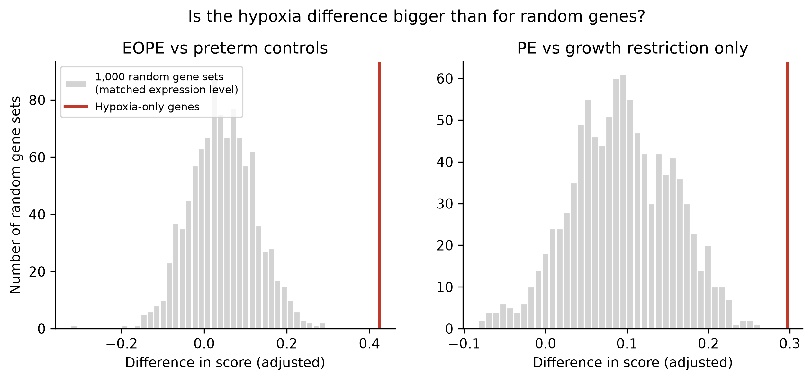
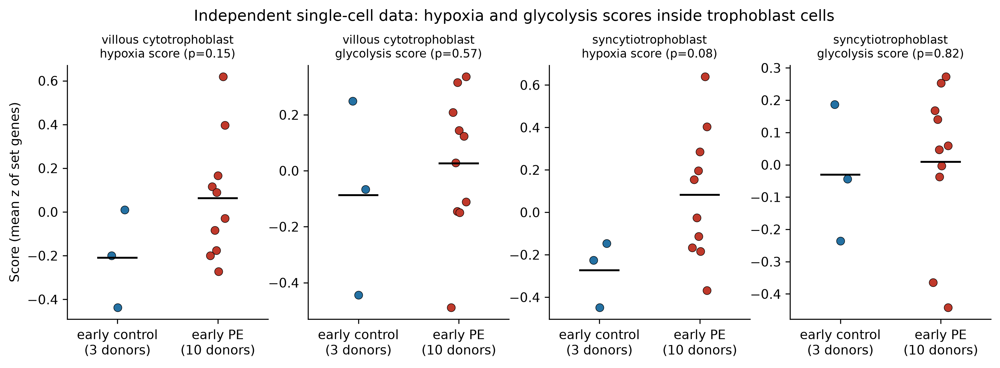

# A Low-Oxygen Alarm in the Preeclampsia Placenta

**In about half of early-preeclampsia placentas, genes that respond to low oxygen are switched on. Placentas of small babies without preeclampsia do not show this, and the alarm rises together with the gene behind the main blood test for the disease.**

By [Team member 1] and [Team member 2]

Figure 1. Low-oxygen gene activity in each of 30 placentas. Each dot is one pregnancy; the black line is the middle value. Several preeclampsia placentas sit far above every healthy or growth-restricted placenta, but others look normal. (Data: GSE203507, Ackerman et al. 2023.)

## Introduction

Preeclampsia is a pregnancy disorder in which the mother's blood pressure rises dangerously, often with kidney and liver damage. It affects a few percent of pregnancies, and the only cure is delivering the placenta. The early-onset form, which appears before 34 weeks, is the most severe and often forces a very premature birth.

Doctors have long suspected that the disease starts in the placenta: if the blood vessels feeding it do not develop properly, the placenta may run short of oxygen and release substances that damage the mother's blood vessels. One of those substances, sFlt-1, is now measured in a blood test (the sFlt-1/PlGF ratio) to help diagnose preeclampsia ([Zeisler et al. 2016](https://doi.org/10.1056/NEJMoa1414838)).

A 2023 study of the placentas we analysed reported that some early-preeclampsia placentas look like they have changed how they burn sugar for energy, a pattern called "glycolysis" ([Ackerman et al. 2023](https://doi.org/10.1161/HYPERTENSIONAHA.122.20807)). We asked four questions about that signal:

1. Does it hold up when preeclampsia placentas are compared with placentas delivered at the *same* stage of pregnancy?
2. Is it specific to preeclampsia, or does it also appear when the baby is simply too small?
3. Is it really about sugar metabolism, or about low oxygen?
4. Which placental cells carry it?

## The Data and Our Methods

We used gene-activity measurements (RNA sequencing) from pieces of 30 placentas collected at delivery ([GSE203507](https://www.ncbi.nlm.nih.gov/geo/query/acc.cgi?acc=GSE203507)): 15 with early preeclampsia (7 of them also with a small baby), 5 with a small baby but no preeclampsia ("fetal growth restriction"), 5 healthy pregnancies that delivered early, and 5 healthy full-term pregnancies. Each pregnancy contributes one sample. We checked our findings in an independent single-cell dataset of 26 pregnancies, where activity was measured separately in each type of placental cell ([Admati et al. 2023](https://doi.org/10.1016/j.medj.2023.07.005)), and in the maternal side of the same placentas (decidua). To avoid fooling ourselves, we wrote down our comparisons and cut-offs and saved them before running any test, and marked every analysis added later as such ([analysis plan](analysis-plan.md)). **The main limit is size: the key control group has only 5 placentas**, and the single-cell check has only 3 early control pregnancies, so our results are exploratory.

## What We Found

### Choosing the right comparison matters

Preeclampsia forces early delivery, so a naive comparison with full-term placentas mixes up "preeclampsia" with "earlier in pregnancy." We therefore compared preeclampsia placentas with healthy placentas delivered at a similar stage (30–33 weeks), and also adjusted for the exact delivery week and the baby's sex.

Figure 2. A map of overall gene activity (principal component analysis): each dot is a placenta, and placentas with similar activity sit close together. Preeclampsia placentas spread to the right, while healthy early and full-term placentas overlap on the left, so in these samples disease mattered more than delivery week for the overall pattern.

A gene's "activity" is how many copies of its message (RNA) the cells are making. Comparing gene by gene, 424 genes differed at least two-fold between preeclampsia and early-delivered healthy placentas with strong statistical support (adjusted p < 0.05). Of these, 207 held up when we also adjusted for delivery week and when we removed each control placenta in turn. Genes already known to be raised in preeclampsia came out as expected: FLT1 (the gene for sFlt-1) was about 8 times higher and LEP (leptin) about 60 times higher.

### The "sugar" signal is really a low-oxygen signal

We then averaged the activity of two published gene lists, 200 genes that cells switch on when oxygen is low ("hypoxia") and 200 genes for breaking down sugar ("glycolysis"), into one score per placenta. The two lists share 65 genes, because cells short of oxygen switch to burning sugar without oxygen. So we split them into three parts: shared genes, low-oxygen-only genes and sugar-only genes.

Figure 3. How much higher each score is in one group than another, after adjusting for delivery week and the baby's sex. Dots are the best estimate; lines are 95% confidence intervals (the range of plausible values). A line that does not cross zero means a clear difference.

- **Low-oxygen-only genes** were higher in early preeclampsia than in early healthy placentas, and **higher than in growth-restricted placentas without preeclampsia** (difference 0.30, 95% interval 0.05 to 0.54). Growth-restricted placentas looked like healthy ones.
- **Shared genes** behaved the same way, and even more strongly.
- **Sugar-only genes did not rise in preeclampsia** (0.07, interval −0.19 to 0.32).

In other words, the "glycolytic" placentas are better described as placentas with an active low-oxygen alarm, part of which happens to involve sugar metabolism. We had first noticed that growth-restricted placentas seemed high in sugar genes; after adjusting for delivery week this became only a weak trend, so we do not claim it.

### Is this just because preeclampsia changes many genes?

When hundreds of genes change, almost any gene list can look different. We tested this directly by drawing 1,000 random gene lists of the same size and activity level.

Figure 4. Grey bars: the differences we would get with random gene lists. Red line: the real low-oxygen genes. The real difference is larger than all 1,000 random lists in both comparisons.

### The alarm tracks the gene behind the clinical blood test

**Placentas with a louder low-oxygen alarm make more FLT1**, the gene that produces sFlt-1. Within the 15 preeclampsia placentas the correlation was strong (Spearman rho = 0.78; 1 means a perfect ranking match). FLT1 is not on the low-oxygen list, so this is not a built-in overlap. The same relationship appeared in placental syncytiotrophoblast cells from the independent single-cell study (rho = 0.72). This fits laboratory work showing that low oxygen directly switches on FLT1 ([Gerber et al. 1997](https://doi.org/10.1074/jbc.272.38.23659)), and that excess placental sFlt-1 causes preeclampsia-like disease in animals ([Maynard et al. 2003](https://doi.org/10.1172/JCI17189)).

Figure 5. Left: each placenta's low-oxygen score against its FLT1 activity. Right: the same in syncytiotrophoblast cells from a separate study of different women.

### Which cells?

The placenta's outer layer, the trophoblast, faces the mother's blood. In the independent single-cell data, the low-oxygen score was higher in early preeclampsia inside both main trophoblast cell types: the stem-like cytotrophoblast and the fused syncytiotrophoblast that makes hormones and sFlt-1. With only 3 control pregnancies, this was suggestive rather than conclusive (p = 0.15 and 0.08), but the direction never flipped when any single pregnancy was removed, and it was clearer when all 26 pregnancies were analysed with delivery week taken into account. The sugar score did not differ.

Figure 6. Scores measured inside trophoblast cells in an independent single-cell dataset. Each dot is one pregnancy.

In the public gene browser from that study, FLT1 and LEP are made mainly by syncytiotrophoblast and invasive (extravillous) trophoblast and appear higher in early preeclampsia; other alarm genes such as NDRG1 and P4HA1 are active across all trophoblast types. A known worry is that preeclampsia placentas may simply contain *more* syncytiotrophoblast, which would raise these genes without any change in behaviour ([Campbell et al. 2023](https://doi.org/10.1038/s42003-023-04623-6)). Marker genes for each cell type did not move together in our data, and adjusting for estimated cell proportions did not shrink the effect, which points to changed behaviour rather than changed cell mix, though our cell-proportion estimates are rough.

## Unanswered Questions

- **Why only some placentas?** About 6 of 15 preeclampsia placentas carry most of the signal. Among the 15, the score did not clearly follow blood pressure, birthweight or delivery week.
- **Placenta or mother?** The maternal-side tissue (decidua) showed a similar rise. That tissue contains invading placental cells, so we cannot yet say whether the alarm is purely placental.
- **Cause or consequence?** Labour and the delivery itself can briefly starve a placenta of oxygen. Our data did not record labour or delivery type for the bulk samples.

## Conclusions, Limitations and Next Steps

Our results suggest that the strongest metabolic signal in early-preeclampsia placentas is a low-oxygen (HIF-type) alarm, not a separate shift in sugar metabolism. It holds up against placentas delivered at the same stage, it is not seen in growth-restricted placentas without preeclampsia, it is larger than for random genes, it appears inside trophoblast cells in a separate study, and it rises with FLT1.

**Our hypothesis:** in a subset of early preeclampsia, trophoblast cells sense low oxygen and switch on a HIF-driven program that includes FLT1, feeding the sFlt-1 excess that harms the mother's blood vessels.

Limitations: very small control groups, bulk tissue that mixes cell types, delivery-related factors we could not measure, and gene activity that shows association, not cause. Several follow-up analyses were planned after we saw our first results; we labelled them as such.

Next steps: (1) repeat the exact same scores in independent placenta datasets with preterm controls; (2) stain the same placentas for the HIF protein and FLT1 and compare with the mother's blood sFlt-1/PlGF ratio; (3) grow trophoblast cells at low versus normal oxygen with and without HIF and check whether the low-oxygen genes and FLT1 rise together. If the low-oxygen score is not higher in preeclampsia in new data, or is just as high in growth restriction, our hypothesis is wrong.

## Data and Code

- Repository: https://github.com/Bakdaulet-omeraiuly/openbio-track1-preeclampsia
- Bulk RNA-seq: [GSE203507](https://www.ncbi.nlm.nih.gov/geo/query/acc.cgi?acc=GSE203507) (Ackerman et al. 2023), via the [OpenBio datathon data package](https://github.com/Harvard-Undergraduate-OpenBio/openbio-datathon-2026/tree/main/track-01/data)
- Single-cell pseudobulk: Admati/Skarbianskis et al. 2023, [figshare](https://figshare.com/articles/dataset/Placenta_PE_single_cell_RNAseq_dataset_Admati_Skarbianskis_et_al_/23264102) (CC BY 4.0)
- Gene browser: [Zeisel lab placenta browser](https://storage.googleapis.com/www_zeisellab/PE_web/pe_web_test_v1.html)
- Gene lists: MSigDB Hallmark v2024.1 ([GSEA-MSigDB](https://www.gsea-msigdb.org/gsea/msigdb))

## Acknowledgements

We thank the Harvard Undergraduate OpenBio team for preparing the datathon data package and guides, the authors of GSE203507 and of the Admati/Skarbianskis single-cell study for sharing their data, and the Harvard Undergraduate Data Project for the article guide.
